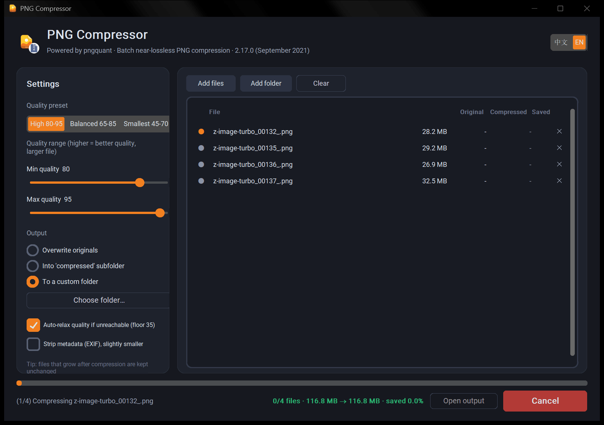

English | [简体中文](README.md)

# PNG Compressor (PNGQuantGUI)

A Windows desktop batch PNG compressor built on [pngquant](https://pngquant.org), featuring a polished dark UI, Chinese/English bilingual support, drag-and-drop, and single-file exe packaging.

pngquant achieves **visually near-lossless** compression via palette quantization (up to 256 colors). Photos are typically 50%–70% smaller with virtually no visible difference in everyday use.

## Screenshot

English UI while a batch is compressing:



## Features

- **Add files**: drag in files or whole folders (`.png` files are found recursively), or use the buttons; individual rows can be removed or the whole list cleared
- **Quality control**: three presets — High 80–95 / Balanced 65–85 / Smallest 45–70 — plus min/max quality sliders for custom ranges
- **Output options**:
  - Into a `compressed` subfolder next to the source (default, originals untouched)
  - Overwrite originals (optionally back them up to an `Original Backup / 原图备份` folder first; existing backups are never overwritten)
  - To a custom folder
- **Safety nets**: files that grow after compression are kept unchanged; quality is auto-relaxed one notch when the target is unreachable (can be disabled); optional EXIF metadata stripping
- **Progress & feedback**: live progress bar, per-file status (✓ done / ≈ kept unchanged / ✕ failed), before/after sizes and savings percentage, cancel anytime, one-click "open output folder" when finished
- **Bilingual UI**: 中文 / English switch in the top-right corner, applied instantly; first launch follows the system language and the choice is persisted
- pngquant runs as an embedded subprocess on a background thread — the UI stays responsive and no command-line window ever flashes

## Requirements

- Windows 10 / 11
- Python 3.9+ (only needed for development and packaging; the built exe needs no Python)

## Run from source

```powershell
pip install customtkinter tkinterdnd2 pillow
python app.py
```

Make sure the following files exist under `assets/`:

| File | Purpose |
|---|---|
| `icon.ico` | Window and exe icon |
| `icon256.png` | Header icon inside the UI |
| `pngquant.exe` | Compression engine ([download](https://pngquant.org) or `npm i pngquant-bin`) |

## Build a single-file exe

```powershell
pip install pyinstaller
pyinstaller "PNG压缩工具.spec"
```

The output is `dist\PNG压缩工具.exe` (~28 MB, double-click to run). You can also run `build.bat`.

## Project structure

```
PNGQuantGUI/
├── app.py              # Main GUI program (CustomTkinter)
├── i18n.py             # zh/en strings, system-language detection, preference persistence
├── PNG压缩工具.spec     # PyInstaller spec
├── build.bat           # One-click build script
├── .gitignore
├── assets/
│   ├── icon.ico
│   ├── icon256.png
│   ├── icon_main256.png
│   └── pngquant.exe
└── docs/
    └── screenshot.png  # Image shown in this README
```

The language preference is stored as `pngquant_gui_config.json` next to the exe (falls back to `%APPDATA%\PNGCompressor` when that folder is not writable).

## License

- The code in this repository is free to use
- [pngquant](https://pngquant.org) is released under **GPLv3**; the bundled `pngquant.exe` is governed by that license — please note its obligations for commercial redistribution
